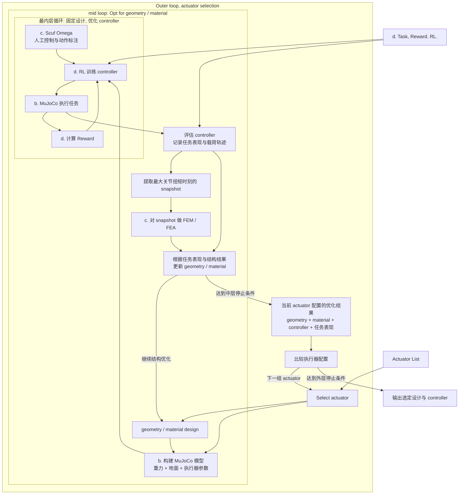
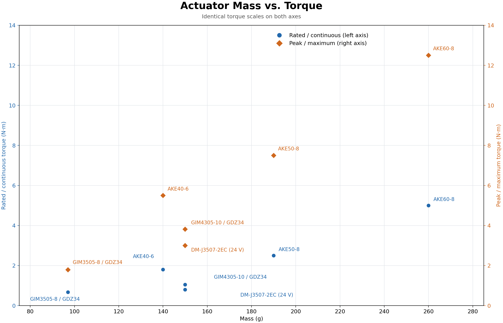

# chihuahua

This repo is trying to build a loop, inner loop, outer loop, co-optimize geometry, material, actuator, controller for a single set of goals: small set of action tasks (3K tasks).

The loop will be:

- Outer loop: actuator, selection from component list
  - Inner loop: geometry, FEM/FEA
    - Inner inner loop: RL control with few human-labeling, Mujoco

With that we'll be able to get an quadrupedal robot that is highly optimized for `wild survival` which is defined by the 3K tasks.

To make it happen, the project comes in multiple phases.

## Code layout

```text
src/
  components/             # Phase 1: reusable components
    tendon/               # CAD assembly study
    model_tools/          # Reference model audits and rendering
    fem_tools/            # FEM result visualization
    plot_actuator_mass_torque.py
    dog_description.py
    endpoint_geometry.py
    mass_model.py
    urdf_linkage.py
    pygame_endpoint_viewer.py
    pygame_mass_viewer.py
    stage3_ik_control.py
    stage4_mujoco_contact.py
    view_mujoco.py
    stage2_rod_model.py
    stage2_openradioss_deck.py
    stage2_openradioss_periodic_motion.py
    stage2_mesh_convergence.py
    pygame_openradioss_fem_viewer.py
  theloop/                # Phase 2: optimization orchestration
    innerloop.py          # Controller training for a fixed design
    midloop.py            # Geometry/material optimization with FEM feedback
    outerloop.py          # Discrete actuator search, no gradient
```

Existing component filenames retain their historical stage numbers during the
folder reorganization. Human action annotation and task/reward/RL components
are not implemented yet. Loop entry points currently raise `NotImplementedError`.
Configuration inputs are Markdown tables in the component and reference directories.

Reference URDFs and their runtime metadata live in `vendor/reference/urdf/`.
Manufacturer motor drawings live in `vendor/components/motor/`.
Generated CAD, model review images, and MuJoCo output live under `artifacts/`
and are ignored by Git. Published documentation figures remain in `docs/`.
Tests remain in `tests/`.

Run components from the repository root as Python modules:

```bash
uv run python -m src.components.pygame_mass_viewer
uv run python -m src.components.view_mujoco
uv run python -m src.components.mass_model --out-dir /tmp/chihuahua_stage1
uv run python -m unittest discover -s tests
```

## Phase 1, proof of concept

Get parts ready:

- a. Basic motion with given geometry;
- b. Mujoco sim with gravity and landing plane;
- c. FEM/FEA at a certain snapshot where the Mujoco gives max torque. The assumption is that when joint torque reaches maximum, the articulation takes the max force.
- c. Human controlled motion annotation with Scuf Omega Wireless PlayStation joystick.
- d. Task definition. Reward definition. RL framework.

## Phase 2, the loop

### 2.1 Construct the loop

With these parts, we construct the outer inner loop:



### 2.2 Differentiable

Build parametric model of actuator set.

希望任务表现的梯度, 能一路传回 actuator 参数, 并且包含 geometry/material 重新优化, controller 重新训练后的影响.

用 $`a`$ 表示 actuator 参数, $`x`$ 表示 geometry/material 参数, $`\theta`$ 表示 controller 参数:

```math
\begin{aligned}
\theta^*(a,x) &= \arg\min_{\theta} L_{\mathrm{RL}}(a,x,\theta) \\
x^*(a) &= \arg\min_{x} L_{\mathrm{design}}\big(a,x,\theta^*(a,x)\big) \\
F(a) &= L_{\mathrm{task}}\big(a,x^*(a),\theta^*(a,x^*(a))\big)
\end{aligned}
```

中层还要满足 FEM 强度等约束. 外层需要的是 $`dF/da`$: 改变执行器后, 让结构和控制器适应它, 最终任务表现会怎样变化. 外层直接优化 component list 的选择权重, 用连续松弛让执行器选型参与求导. 假设每个关节 $`j`$ 有 $`K`$ 个候选执行器, 为它们设置可训练参数 $`\alpha_{j,k}`$:

```math
p_{j,k} = \frac{\exp(\alpha_{j,k}/\tau)}{\sum_{\ell=1}^{K}\exp(\alpha_{j,\ell}/\tau)}
```

$`p_{j,k}`$ 是选择权重, $`\tau`$ 控制选择有多集中. 你的 actuator parametric model 用这些权重生成松弛后的执行器模型, 例如:

```math
m_j=\sum_k p_{j,k}m_k,\qquad T_j(\omega)=\sum_k p_{j,k}T_k(\omega)
```

质量, 尺寸, 惯量, 扭矩-转速曲线等都必须使用**同一组选择权重**, 避免分别挑选各型号最有利的属性.

三层循环于是变成:

```text
外层更新 actuator 选择参数 α
    ↓ softmax
各关节的候选权重 p
    ↓ actuator parametric model
松弛后的执行器物理模型
    ↓
中层优化 geometry / material
    ↓
内层训练 controller
    ↓
任务表现 + FEM 约束
    ↓
梯度穿过内部优化, 更新 α
```

连续松弛解决了"候选选择"这个离散节点. MuJoCo, FEM, 快照选择以及内部训练更新的求导路径, 仍需要接通, 才能得到你要的外层梯度. 最后逐渐降低温度, 让权重集中, 再取:

```math
k_j^*=\arg\max_k p_{j,k}
```

得到实际采购型号. 降温不保证自动成为 one-hot; 最终离散化后, 需要重新优化结构, 训练控制器并验证, 因为优化过程中使用的混合执行器可能没有对应实物. 用连续权重搜索执行器组合, 让经过结构优化和控制训练后的任务表现决定选型.

---


## Actuator vendor list

| 厂商/型号                           | 重量 g | 额定/持续扭矩 N·m | 峰值/最大扭矩 N·m | 减速比 | 驱动器   | Sources                                                                                                                                                                                                                                                                                                                                                                                                                                                                                             |
| ------------------------------- | ---- | ----------- | ----------- | --- | ----- | --------------------------------------------------------------------------------------------------------------------------------------------------------------------------------------------------------------------------------------------------------------------------------------------------------------------------------------------------------------------------------------------------------------------------------------------------------------------------------------------------- |
| CubeMars AKE40-6                | 140  | 1.8         | 5.5         | 6   | 外配    | [官方系列参数表](https://www.cubemars.com/product/ake50-8-kv110-quasi-direct-drive-actuator.html)                                                                                                                                                                                                                                                                                                                                                                                                          |
| CubeMars AKE50-8                | 190  | 2.5         | 7.5         | 8   | 外配    | [厂家](https://www.cubemars.com/product/ake50-8-kv110-quasi-direct-drive-actuator.html)                                                                                                                                                                                                                                                                                                                                                                                                               |
| CubeMars AKE60-8                | 260  | 5           | 12.5        | 8   | 外配    | [厂家](https://www.cubemars.com/product/ake60-8-kv80-quasi-direct-drive-actuator.html)                                                                                                                                                                                                                                                                                                                                                                                                                |
| SteadyWin GIM3505-8 V1.1+GDZ34  | 97   | 0.67        | 1.79        | 8   | GDZ34 | [产品页](https://steadywin-motor.com/products/built-in-planetary-reduction-motor-aloha-accessories-quadruped-robot-joint-module) · [GDZ 参数表](https://dd-prod-us-west.s3.us-west-004.backblazeb2.com/files/pc3kjn-ep/1594c9b8/Planetary-Reduction-Motor-Selection-Table-GDZ-Driver.xlsx) · [RCDrone (版本待核对)](https://rcdrone.top/products/steadywin-gim3505-8-planetary-reducer-servo-motor)                                                                                                             |
| SteadyWin GIM4305-10 V1.1+GDZ34 | 150  | 1.05        | 3.82        | 10  | GDZ34 | [产品页](https://steadywin-motor.com/products/built-in-planetary-reduction-motor-aloha-accessories-quadruped-robot-joint-module-2) · [GDZ 参数表](https://dd-prod-us-west.s3.us-west-004.backblazeb2.com/files/pc3kjn-ep/1594c9b8/Planetary-Reduction-Motor-Selection-Table-GDZ-Driver.xlsx) · [AIFitLab (配置待核对)](https://aifitlab.com/products/steadywin-gim4305-planetary-reducer-servo-motor) · [Pupper V3 (配置待核对)](https://pupper-v3-documentation.readthedocs.io/en/latest/learn_more/tech_specs.html) |
| DAMIAO DM-J3507-2EC (24 V)        | 150  | 0.8         | 3           | 7   | 内置    | [厂家](https://www.mdmbot.com/index.php?c=show&id=118) · [AIFitLab](https://aifitlab.com/products/damiao-dm-j3507-2ec-motor) · [RoboticsCenter](https://www.roboticscenter.ai/ar/store/product/damiao-dm-j3507-2ec)                                                                                                                                                                                                                                                                                   |



---

mechanical tendon stop + 凹轮


---


| 尚未覆盖的内容          | `docs` 中的具体含义                                                                                                                          | 在新架构中的位置                                                  | Pere comment              |
| ---------------- | -------------------------------------------------------------------------------------------------------------------------------------- | --------------------------------------------------------- | ------------------------- |
| **任务集本身如何修正**    | 野外结果 → 证据 → 更新设计目标; 每条目标要能追溯来源, 或标记为假设. [来源](docs/SURVIVAL_TO_DESIGN_GOALS.md)                            | README 固定了任务集, 还没有覆盖如何验证这些任务确实代表 wild survival.             | 3K tasks 定义 wild survival |
| **行为风格目标**       | ADM 动作先验, 动物动作数据 retargeting, 行为 embedding, 以及与 Chihuahua 行为分布的距离. [来源](docs/adm_geometry_optimization.md) | 当前 Task / Reward 没有明确包含"行为像 Chihuahua". 这是额外目标, 是否保留需要单独决定.  | ADM 是什么?                  |
| **完整质量与供电模型**    | 电池, 驱动器, 线束, 电子设备, 紧固件, 轴承的质量, 空间和安装位置; 更新 COM/惯量. [来源 (line 195)](docs/TOP_LEVEL_DESIGN.md#L195)               | 应进入 geometry/actuator 的物理模型, 否则优化遗漏整机成本.                    | merge docs 中的content      |
| **材料与制造约束**      | FDM 各向异性, 层间强度, 疲劳, 打印方向, 最小壁厚, 装配公差, 以及试样校准. [来源 (line 143)](docs/TOP_LEVEL_DESIGN.md#L143)                   | README 的 `material` 尚未展开这些变量和约束.                           | merge docs 中的content      |
| **传动与关节架构**      | 串/并联弹性, 机械限位, 离合/制动, 回驱, 冲击承受能力, 可变刚度; 近端驱动与远端轻量化. [来源](docs/yellowstone.md)                                  | 当前 actuator 连续松弛主要描述选型; 这些机构参数是否一起优化尚未定义.                   | good point.               |
| **形态搜索范围**       | 可控刚度脊柱, 肩带活动, 骨盆与脊柱的载荷传递. [来源](docs/spine.md)                                                             | `geometry` 到底只优化固定拓扑的尺寸, 还是允许关节拓扑/自由度变化, 目前没有说明.             | `脊柱, 肩带活动, 骨盆与脊柱` 都无法实现, 太重 |
| **复杂地形与拒绝/恢复行为** | 不平地面, 坡度, 台阶, 摩擦, 落脚点选择, 以及危险地形拒绝进入与恢复. [来源](docs/STAGE_5_COMPLEX_TERRAIN_IK.md)                             | 可以归入任务集, 环境分布和评估条件; PoC 当前只有地面.                              | defined in 3K tasks       |
| **每轮可追溯记录**      | 设计版本, 物理假设, 质量/惯量, 载荷, FEM 结果, 控制限制和下一步设计决定. [来源 (line 581)](docs/TOP_LEVEL_DESIGN.md#L581)                   | 三层优化需要统一的实验记录, 才能重现和比较结果.                                   | not a big deal            |

旧文档有几处需要和新方向明确划界:

- **FEM 范围与载荷来源**: 旧文档要求整机 FEM, 原生工况来自 Stage 1 自由空间 torque replay, 排除重力/接触. 新版采用 MuJoCo snapshot, 需要重新定义载荷传递, 边界条件, 以及是否继续坚持整机分析. [旧定义](docs/STAGE_2_WHOLE_ROBOT_FEM.md)
- **已有反馈接口的能力边界**: Stage 4 文档记录真实 MuJoCo 接触力, 但写给 Stage 2 的反馈仍来自准静态支撑力 proxy, 且没有自动施加到 FEM. 新 README 的这条链仍是待实现目标. [接口说明 (line 111)](docs/STAGE_4_MUJOCO_CONTACT.md#L111)
- **旧阶段顺序与优化方法**: 旧路线按 FEM → IK → MuJoCo 分阶段推进; ADM 文档建议无梯度几何优化. 它们需要标记为历史路线, 避免与新的可微三层循环并列成为实施要求.
- **旧 fallback 策略**: FEM 文档允许缺失 beam resultants 时退回位移推算应变. 这与你现在要求的 fail loud 不一致, 重构时需要明确处理. [记录 (line 423)](docs/STAGE_2_OPENRADIOSS_FIRST_LIGHT.md#L423)

## Scope

- Core tasks: ~10.
- Outer loop: discrete search, no gradient.

## Related work

- 形态和控制联合优化: Sims 1994 的进化虚拟生物; Schaff et al. 2019 和 Ha 2019 用 RL 同时优化结构和控制器; Gupta et al. 2021 (DERL, 发在 Nature Communications).
- 可微协同设计: Spielberg et al. 2019 在软体机器人上做 learning-in-the-loop, 梯度能穿过仿真; Evolution Gym (2021).
- 真实四足上的协同设计: Bjelonic et al. 2023 在四足上联合优化并联弹性执行器和 RL 控制器, 但只是少数几个参数.
- [Dogger](https://arxiv.org/abs/2611.02462) (arXiv 2611.02462, 2026 年 11 月刚出): 做法是先训练一个以形态为条件的 RL policy, 再用贝叶斯优化按任务选形态, 最后造了真机. 它的外层是离散/无梯度搜索, 和你的 Scope 思路一致; 但它不选执行器, 也不做 FEM.
- Hutter 组 Meta-RL legged design ([ResearchGate](https://www.researchgate.net/publication/364159223_Meta_Reinforcement_Learning_for_Optimal_Design_of_Legged_Robots)): 把减速比映射成执行器的质量, 效率和峰值扭矩, 用 CMA-ES 和 RL 一起优化. 在执行器选型这件事上, 它离你最近.
- [COSMIC](https://arxiv.org/html/2605.12654) (arXiv 2605.12654): 拓扑, 材料和控制器在同一个可微框架里联合优化, 相当于把 FEM 式结构优化放进了梯度链. 但对象只是桁架机器人, 没有造真机.
- 其他: [Dinev et al. 2021](https://arxiv.org/pdf/2103.04660) 做了四足减速比和杆长的双层优化; [ETH IJRR 2018](https://crl.ethz.ch/papers/IJRR_2018.pdf) 联合优化设计参数和运动; [并联弹性执行器 + RL](https://arxiv.org/pdf/2301.03509).
