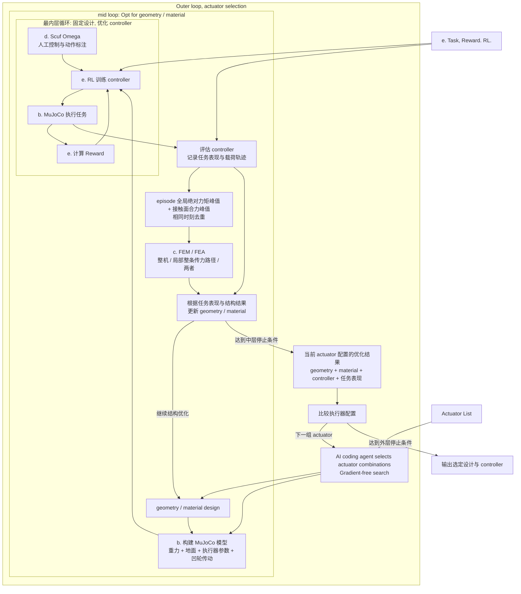

# chihuahua

https://chiwuawua.com/

This repo is trying to build a loop, inner loop, outer loop, co-optimize geometry, material, actuator, controller for a single set of goals: small set of action tasks (3K tasks).

The loop will be:

- Outer loop: actuator, selection from component list
  - Inner loop: geometry, FEM/FEA
    - Inner inner loop: RL control with few human-labeling, Mujoco

With that we'll be able to get an quadrupedal robot that is highly optimized for `wild survival` which is defined by the 3K tasks.

To make it happen, the project comes in two phases.

## Phase 1, proof of concept

Get parts ready:

- a. Basic motion with given geometry;
- b. Mujoco sim with gravity and landing plane;
- c. FEM/FEA on snapshots selected from MuJoCo joint-side actuation torque and contact-surface resultant force peaks; whole-body, local load-path, or both. The assumption is that when joint torque reaches maximum, the articulation takes the max force.
- d. Human controlled motion annotation with Scuf Omega Wireless PlayStation joystick.
- e. Task definition. Reward definition. RL framework.

## Phase 2, the loop

### 2.1 Construct the loop

With these parts, we construct the outer inner loop:



### 2.2 Differentiable

Build parametric model of the actuator set.

希望任务表现的梯度, 能一路传回 actuator 参数, 并且包含 geometry/material 重新优化, controller 重新训练后的影响.

用 $`a`$ 表示 actuator 参数, $`x`$ 表示 geometry/material 参数, $`\theta`$ 表示 controller 参数:

```math
\begin{aligned}
\theta^*(a,x) &= \arg\min_{\theta} L_{\mathrm{RL}}(a,x,\theta) \\
x^*(a) &= \arg\min_{x} L_{\mathrm{design}}\big(a,x,\theta^*(a,x)\big) \\
F(a) &= L_{\mathrm{task}}\big(a,x^*(a),\theta^*(a,x^*(a))\big)
\end{aligned}
```

中层要满足 FEM 强度等约束. 外层需要的是 $`dF/da`$: 改变执行器后, 让结构和控制器适应它, 最终任务表现会怎样变化. 外层直接优化 component list 的选择权重, 用连续松弛让执行器选型参与求导. 假设每个关节 $`j`$ 有 $`K`$ 个候选执行器, 为它们设置可训练参数 $`\alpha_{j,k}`$:


```text
外层更新 actuator 选择参数 α
    ↓ actuator parametric model
松弛后的执行器物理模型
    ↓
中层优化 geometry / material
    ↓
内层训练 controller
    ↓
任务表现 + FEM 约束
    ↓
梯度穿过内部优化, 更新 α
```

连续松弛希望可以解决"候选选择"这个离散节点, 但设计上讲, 也会keep eye open to AI coding driven iteration: 由AI harness review 中层优化的结果, 判定外层searching candidates. MuJoCo, FEM, snapshot选择以及内部训练更新的求导路径, 仍需要接通, 才能得到外层梯度. 取:

```math
k_j^*=\arg\max_k p_{j,k}
```

得到实际采购型号. 最终离散化后, 需要重新优化结构, 训练控制器并验证, 优化过程中使用的混合执行器可能没有对应实物. 用连续权重搜索执行器组合, 让经过结构优化和控制训练后的任务表现决定选型.


---


## Related work

- 形态和控制联合优化: Sims 1994 的进化虚拟生物; Schaff et al. 2019 和 Ha 2019 用 RL 同时优化结构和控制器; Gupta et al. 2021 (DERL, 发在 Nature Communications).
- 可微协同设计: Spielberg et al. 2019 在软体机器人上做 learning-in-the-loop, 梯度能穿过仿真; Evolution Gym (2021).
- 真实四足上的协同设计: Bjelonic et al. 2023 在四足上联合优化并联弹性执行器和 RL 控制器, 但只是少数几个参数.
- [Dogger](https://arxiv.org/abs/2611.02462) (arXiv 2611.02462, 2026 年 11 月刚出): 做法是先训练一个以形态为条件的 RL policy, 再用贝叶斯优化按任务选形态, 最后造了真机. 它的外层是离散/无梯度搜索, 和你的 Scope 思路一致; 但它不选执行器, 也不做 FEM.
- Hutter 组 Meta-RL legged design ([ResearchGate](https://www.researchgate.net/publication/364159223_Meta_Reinforcement_Learning_for_Optimal_Design_of_Legged_Robots)): 把减速比映射成执行器的质量, 效率和峰值扭矩, 用 CMA-ES 和 RL 一起优化. 在执行器选型这件事上, 它离你最近.
- [COSMIC](https://arxiv.org/html/2605.12654) (arXiv 2605.12654): 拓扑, 材料和控制器在同一个可微框架里联合优化, 相当于把 FEM 式结构优化放进了梯度链. 但对象只是桁架机器人, 没有造真机.
- 其他: [Dinev et al. 2021](https://arxiv.org/pdf/2103.04660) 做了四足减速比和杆长的双层优化; [ETH IJRR 2018](https://crl.ethz.ch/papers/IJRR_2018.pdf) 联合优化设计参数和运动; [并联弹性执行器 + RL](https://arxiv.org/pdf/2301.03509).

---

---


## 模型对比 viewer

`uv run python -m src.components.a_basic_motion.pygame_mass_viewer --model go2`（也可选 `aibo`、`chihuahua`、`pupper`）。
窗口内按 `1/2/3/4` 切换 Chihuahua / Go2 / Aibo ERS-7 / Pupper v3；Go2 和 Aibo 保留 URDF 拓扑，关节角度遵守 URDF 限位。
`B` 全身转动，`M` 单关节，`N` 或 `[/]` 选关节，左右键或横拖关节行调角；`空格` 暂停，`0` 零姿态，`F` 居中，`V` 切换 mesh 包围盒。
模型显示为骨架及包围盒；质量/COM 取自 URDF。`R` 切换自动目标触达，`G` 切换关节控制条；自动选择脚端（Aibo 还包括头部）。`Y` 显示共用材料／力矩面板；URDF 用相对密度缩放质量，力矩裕度使用 `effort` 上限。[模型来源](vendor/reference/urdf/README.md)。


## 终极目标

构建一只能够由 Bambu 系列 FDM 打印机制造主要结构件的机械四肢动物。

目标是建立一个可以收敛的机电设计流程：

```text
geometry
 -> mass / inertia / torque model
 -> structural FEM iteration
 -> IK and control
 -> MuJoCo simulation
 -> complex terrain IK
 -> printable CAD implementation
```

这个项目的核心判断是：

```text
actuator mass increases torque
torque increases structure size
structure size increases mass
mass increases battery size
battery size increases mass
mass shifts COM
COM changes torque and control
```

每个阶段都更新质量、重心、惯量、力矩裕度和结构强度。

## 当前仓库角色

当前仓库已经有 yaw/pitch-waist quadruped 的几何雏形：

```text
vendor/reference/urdf/chihuahua/lists.md
endpoint_geometry.py
pygame_endpoint_viewer.py
```

这些代码目前主要回答：

```text
关节拓扑是什么？
hip / endpoint 的几何关系是什么？
腰部 yaw/pitch 后 endpoint reach 是否合理？
关节范围和 linkage 外观是否直觉上成立？
```

下一步要把它从 kinematic sketch 升级为 electromechanical design bench。

## Prerequisites

在正式做 CAD / IK / MuJoCo 之前，需要先建立物理参数表。没有这些参数，后面的 torque、FEM 和 control 都会漂。

### Material Model

需要记录每种候选打印材料的：

```text
density
Young's modulus
Poisson ratio
yield strength
ultimate strength
fatigue assumption
layer adhesion strength
anisotropy factor
recommended print orientation
```

FDM 打印件不能当作各向同性实体。XY 平面强度、Z 向层间强度、孔周围强度、薄壁强度都需要分开处理。

候选材料可以分级：

```text
PLA / PLA+
PETG
ASA / ABS
PA-CF / PAHT-CF
TPU for feet and pads
```

早期仿真可以用保守近似值，但阶段 2 前后需要打印 coupon / test pieces 来校准 FEM 参数。

### Actuator Model

每个候选 actuator 需要至少包含：

```text
mass
dimensions
mounting pattern
max torque
continuous torque
stall torque
max speed
gear ratio
backlash
thermal limit
current draw
voltage
driver mass
```

actuator 提供 torque，它本身也是 mass，并且通常在离 COM 很远的位置。actuator placement 会直接改变 torque requirement。

### Battery And Electronics Model

需要记录：

```text
battery mass
battery volume
battery voltage
usable capacity
peak current
continuous current
BMS / protection assumptions
controller mass
driver mass
wire mass
connector mass
```

电池质量不能当作后期附加物。它会显著改变 COM、支撑多边形、关节 torque 和摔倒载荷。

### Fastener And Bearing Model

需要建立标准件库：

```text
screws
heat-set inserts
shafts
bearings
bushings
washers
spacers
pins
```

每个标准件都要有 mass、尺寸、安装约束和载荷假设。不要每个关节发明一种紧固方式。

### Printability Model

需要记录打印约束：

```text
build volume
minimum wall thickness
minimum rib thickness
hole compensation
insert hole dimensions
overhang limits
support accessibility
print orientation
post-processing assumptions
```

打印方向会影响强度，它参与 FEM 和 CAD 迭代。

## Basic motion: Free-Motion Mass And Torque Body

把当前关节几何展开成带有 mass、COM、inertia 和 torque limit 的 free-motion rigid body model。

这一阶段仍然不做结构破坏分析，也不做完整控制。目标是让系统知道：

```text
每个 link 有多重
每个 link 的 COM 在哪里
每个 link 的 inertia tensor 是什么
每个 joint axis 在哪里
每个 joint 的 torque / speed limit 是多少
actuator 放在哪里
battery 和 electronics 放在哪里
```

核心输出：

```text
rigid body tree
link mass table
joint torque table
static pose torque estimate
worst-pose torque estimate
COM estimate
actuator margin estimate
```

阶段 1 要回答的问题：

```text
当前几何下，站立姿态需要多少 torque？
腰部 yaw/pitch 后 torque 是否爆掉？
单腿抬起时，支撑腿 torque 是否还有余量？
actuator mass 是否导致 torque 递归增大？
battery 放在哪里 COM 最合理？
```

这一阶段应该允许粗略 geometry placeholders，但 mass、COM 和 torque 数据必须结构化。

## FEM: Whole-Robot FEM

以整只机器人作为唯一 FEM 分析对象。

这一阶段不建立 single-link、bracket、shaft seat、insert region 或 subassembly 的独立 FEM 路线。局部区域可以在整机结果中表现为 stress / deformation hot spot，但判断、加强和复验都回到 whole-robot FEM 中完成。

FEM FEM load case 应来自阶段 1 的质量、惯量、姿态和 joint torque
估计，但这一阶段不引入 gravity、ground contact、support reaction 或
fixed feet。重力、接触和支撑稳定性属于后续 MuJoCo/contact 阶段；MuJoCo
结果再回灌 FEM，生成新的无重力结构复验工况。

```text
max joint torque
continuous joint torque
worst-case pose
actuator / battery lumped mass inertia
waist yaw / pitch extreme pose
torque replay articulated bend
motion-slice inertial load from Basic motion
mesh / material / radius comparison under the same torque replay
```

FEM 要找：

```text
global body deformation
body torsion
waist load path weakness
hip frame deformation
joint axis misalignment
endpoint deflection under load
whole-body torque / inertia load distribution
torque reaction load path
stress hot spots
layer delamination risk
fatigue-sensitive regions
```

加强方式包括：

```text
wall thickness change
rib placement
fillet radius
hole relocation
boss geometry
print orientation change
material change
load path redesign
standard part substitution
full-frame stiffness redistribution
actuator / battery placement change
```

每次加强之后必须更新：

```text
mass
COM
inertia
joint torque estimate
battery estimate if needed
FEM result
```

阶段 2 是一个循环：

```text
whole-robot FEM stress / deformation hot spot
 -> full-model geometry reinforcement
 -> mass update
 -> torque update
 -> COM update
 -> new whole-robot FEM load case
 -> whole-robot FEM again
```

## IK control: IK And Control Development

当 mass、torque 和整机结构经过几轮 FEM 后，开始加入 IK 和控制。

早期可以先写 rough IK 来生成 load cases；正式 IK/control 在这一阶段系统化。

IK control first-light 记录在 [IK 文档](src/components/d_motion_annotation_and_ik/README.md)。当前实现先建立
IK、trajectory primitive、torque margin checker 和几何级 support polygon
awareness；MuJoCo/contact 仍属于 MuJoCo。

核心能力：

```text
foot target to joint angles
joint limit avoidance
torque-aware pose selection
body height control
foot trajectory generation
support polygon awareness
COM-aware stepping
simple gait state machine
fall / overload detection
```

控制开发要带着工程约束：

```text
不要生成 torque margin 不足的动作
不要让整机 FEM 中的高风险姿态长期处在高载荷或大变形状态
不要让脚端轨迹逼近 joint limit
不要让 body pose 把 COM 推出支撑区域
```

阶段 3 的输出：

```text
IK solver
joint trajectory generator
gait primitives
torque margin checker
control-side safety limits
simulation-ready actuator commands
```

## MuJoCo: CAD And Control In MuJoCo

把经过阶段 1-3 迭代的 CAD / rigid body / control 放进 MuJoCo。

MuJoCo first-light 记录在 [MuJoCo 文档](src/components/b_mujoco_sim/README.md)。当前实现先建立
MuJoCo XML export、foot contact geometry、准静态支撑反力 proxy 和
FEM feedback load-case table；闭环 balance 和真实动态步态仍是后续工作。

MuJoCo 模型需要包含：

```text
link geometry
realistic mass
realistic inertia
joint axes
joint limits
actuator torque limits
actuator velocity limits
contact geometry
foot friction
battery / electronics lumped mass
controller loop
```

这一阶段验证：

```text
能否站立
能否低速移动
能否抬腿
能否转身
摔倒模式是什么
哪些关节 torque 经常饱和
哪些姿态让 COM 变危险
脚端接触是否稳定
控制是否依赖不现实的 actuator performance
```

MuJoCo 结果可能会推翻前面的设计，因此阶段 4 之后还要回到阶段 1/2/3：

```text
MuJoCo failure
 -> update load case
 -> update FEM / CAD
 -> update mass / inertia
 -> update IK / control
 -> simulate again
```

## Stage 5: Complex Terrain IK

阶段 4 做完之后，不应该立刻进入打印。Stage 5 的目标是把前面得到的
mass、torque、FEM、IK 和 MuJoCo 结果转成复杂地形上的运动能力定义。

Stage 5 不做新的结构设计，不启动打印实施，也不把 MuJoCo first-light 当成
真实野外能力。它专门回答：

```text
复杂地形下脚该落在哪里？
body pose 应该如何随地形变化？
IK 如何避开 joint limit 和 torque limit？
支撑脚集合如何切换？
COM 如何留在可恢复区域？
哪些地形应该拒绝进入？
```

Stage 5 的核心输入：

```text
Basic motion mass / COM / torque margin
FEM FEM hot spots and load-path limits
IK control IK / control safety limits
MuJoCo contact and failure evidence
terrain height samples / slope / step edges
foot friction assumptions
support polygon / contact candidate set
```

Stage 5 的核心能力：

```text
terrain-aware foot target selection
terrain-aware body height and body attitude selection
per-leg IK over uneven contact targets
support-foot scheduling
COM and support polygon check
torque margin check under terrain pose
joint-limit avoidance
terrain refusal / recovery decision
MuJoCo replay of terrain IK commands
```

Stage 5 的输出：

```text
terrain IK solver
terrain gait command table
terrain contact candidate table
terrain safety / refusal rules
terrain replay cases for MuJoCo
failure mode report
updated control limits
```

阶段 5 做完后，才允许讨论打印实施。

## Stage 6: Printing Implementation

只有当 mass、torque、FEM、IK、MuJoCo 和复杂地形 IK 都达到最低可信度之后，
才开始完整打印实施。

打印实施验证制造和装配：

```text
print orientation
support removal
surface quality
insert installation
shaft / bearing fit
assembly sequence
wire routing
serviceability
field repair
```

阶段 6 应该优先打印：

```text
material coupons
joint coupons
single link
single bracket
single leg
waist module
half body
full body
```

最终整机打印前，必须已有：

```text
known material parameters
known tolerance table
known fastener standard
known actuator placement
known battery placement
known COM estimate
known torque margin
known FEM margin
known MuJoCo behavior
known complex terrain IK behavior
```

## Development Loop

主循环应该是：

```text
1. update geometry / CAD
2. compute mass / COM / inertia
3. compute static and motion torque
4. run whole-robot FEM
5. update reinforcement
6. update IK / control limits
7. run MuJoCo
8. update complex terrain IK
9. record failure modes
10. repeat
```

每一轮至少记录：

```text
design version
geometry parameters
material assumptions
actuator assumptions
battery assumptions
mass table
COM
joint torque margins
whole-robot FEM stress / deformation hot spots
control limitations
MuJoCo results
complex terrain IK results
next design decision
```

## Immediate Repo Direction

下一步代码层面应该做这些事情：

```text
1. Add structured physical parameter files.
2. Extend RobotGeometry into mass / inertia / actuator-aware model.
3. Add link mass and COM calculation.
4. Add static torque estimation for representative poses.
5. Add versioned design reports.
6. Document external FEM FEM dependencies.
7. Prepare whole-robot FEM export / load-case generation.
8. Define complex terrain IK stage before printing.
9. Later prepare printing implementation.
```

建议新增文件结构：

```text
vendor/components/material/lists.md
vendor/components/joint/lists.md
vendor/components/battery/lists.md
fasteners.yaml
design_state.py
mass_model.py
torque_model.py
fem_loadcases.py
mujoco_export.py
terrain_ik.py
```

当前 `endpoint_geometry.py` 可以保留为几何压力计，但它不应该再是项目的顶层真相。顶层真相应该变成：

```text
geometry + mass + torque + strength + control + simulation
```

## Design Philosophy

这个项目的重点是建立一个能够让机械四肢动物收敛的设计系统。

最重要的约束是：

```text
mass is not metadata
torque is not optional
FEM is not post-processing
control is not separate from CAD
printing is not the first prototype
```

只有当这些约束一起闭环，最终的 printed quadruped 才有机会不是一次性展示品，而是一个可以迭代、可以修、可以运动的机械动物。


