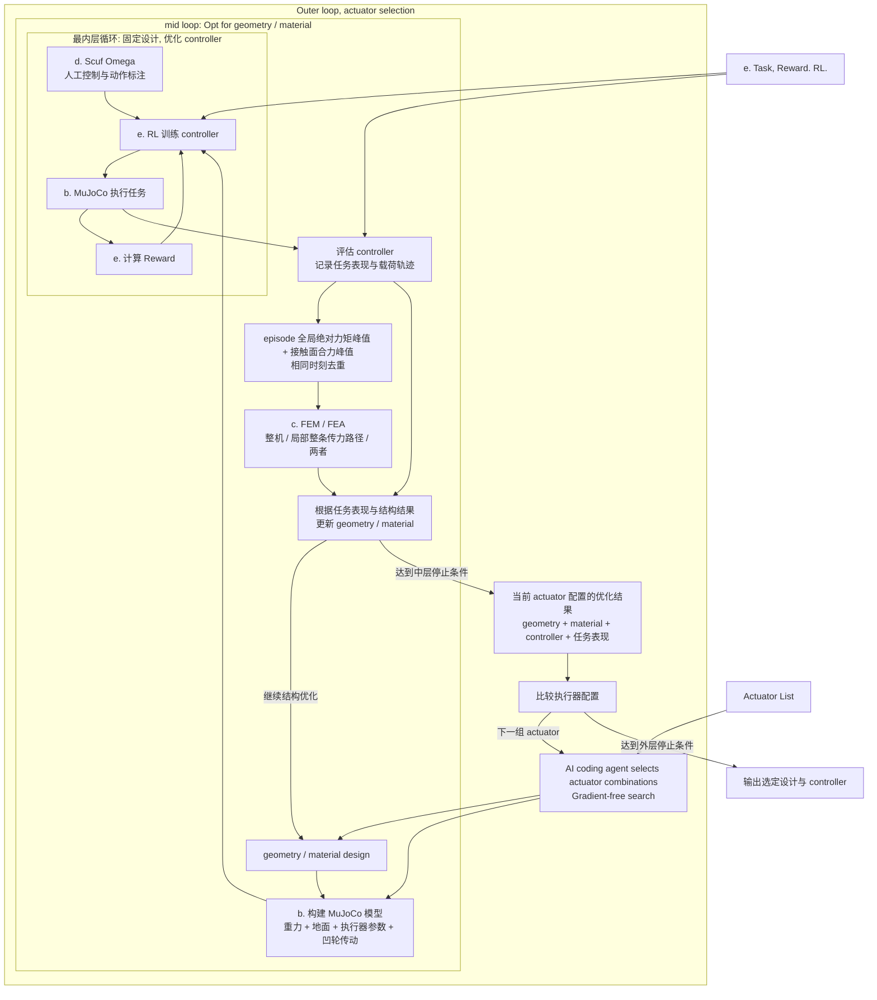

# chihuahua

https://chiwuawua.com/

This repo is trying to build a loop, inner loop, outer loop, co-optimize geometry, material, actuator, controller for a single set of goals: small set of action tasks (3K tasks). With the design, we'll able to build up a quadrupedal robot。

The loop will be:

- Outer loop: actuator, selection from component list
  - Inner loop: geometry, FEM/FEA
    - Inner inner loop: RL control with few human-labeling, Mujoco

With that we'll be able to get an quadrupedal robot that is highly optimized for `wild survival` which is defined by the 3K tasks.

To make it happen, the project comes in two phases.

## Phase 1, proof of concept

Get parts ready:

- a. Basic motion with given geometry;
- b. Mujoco sim with gravity and landing plane;
- c. FEM/FEA on snapshots selected from MuJoCo joint-side actuation torque and contact-surface resultant force peaks; whole-body, local load-path, or both. The assumption is that when joint torque reaches maximum, the articulation takes the max force.
- d. Human controlled motion annotation with Scuf Omega Wireless PlayStation joystick.
- e. Task definition. Reward definition. RL framework.

## Phase 2, the loop

### 2.1 Construct the loop

With these parts, we construct the outer inner loop:



### 2.2 Differentiable

Build parametric model of the actuator set.

希望任务表现的梯度, 能一路传回 actuator 参数, 并且包含 geometry/material 重新优化, controller 重新训练后的影响.

用 $`a`$ 表示 actuator 参数, $`x`$ 表示 geometry/material 参数, $`\theta`$ 表示 controller 参数:

```math
\begin{aligned}
\theta^*(a,x) &= \arg\min_{\theta} L_{\mathrm{RL}}(a,x,\theta) \\
x^*(a) &= \arg\min_{x} L_{\mathrm{design}}\big(a,x,\theta^*(a,x)\big) \\
F(a) &= L_{\mathrm{task}}\big(a,x^*(a),\theta^*(a,x^*(a))\big)
\end{aligned}
```

中层要满足 FEM 强度等约束. 外层需要的是 $`dF/da`$: 改变执行器后, 让结构和控制器适应它, 最终任务表现会怎样变化. 外层直接优化 component list 的选择权重, 用连续松弛让执行器选型参与求导. 假设每个关节 $`j`$ 有 $`K`$ 个候选执行器, 为它们设置可训练参数 $`\alpha_{j,k}`$:


```text
外层更新 actuator 选择参数 α
    ↓ actuator parametric model
松弛后的执行器物理模型
    ↓
中层优化 geometry / material
    ↓
内层训练 controller
    ↓
任务表现 + FEM 约束
    ↓
梯度穿过内部优化, 更新 α
```

连续松弛希望可以解决"候选选择"这个离散节点, 但设计上讲, 也会keep eye open to AI coding driven iteration: 由AI harness review 中层优化的结果, 判定外层searching candidates. MuJoCo, FEM, snapshot选择以及内部训练更新的求导路径, 仍需要接通, 才能得到外层梯度. 取:

```math
k_j^*=\arg\max_k p_{j,k}
```

得到实际采购型号. 最终离散化后, 需要重新优化结构, 训练控制器并验证, 优化过程中使用的混合执行器可能没有对应实物. 用连续权重搜索执行器组合, 让经过结构优化和控制训练后的任务表现决定选型.