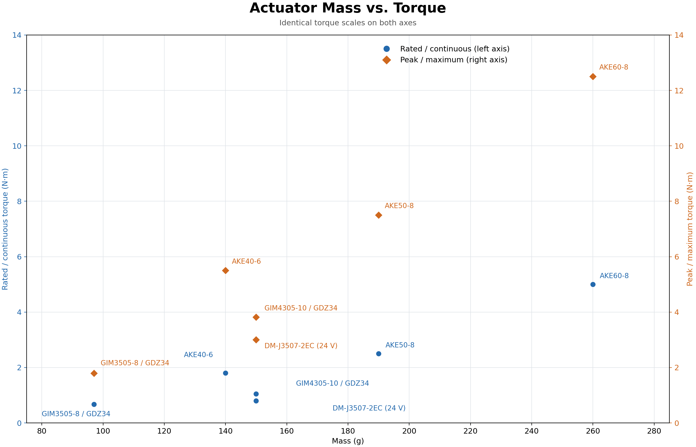

## Actuator vendor list

| 厂商/型号                           | 重量 g | 额定/持续扭矩 N·m | 峰值/最大扭矩 N·m | 减速比 | 驱动器   | Sources                                                                                                                                                                                                                                                                                                                                                                                                                                                                                             |
| ------------------------------- | ---- | ----------- | ----------- | --- | ----- | --------------------------------------------------------------------------------------------------------------------------------------------------------------------------------------------------------------------------------------------------------------------------------------------------------------------------------------------------------------------------------------------------------------------------------------------------------------------------------------------------- |
| CubeMars AKE40-6                | 140  | 1.8         | 5.5         | 6   | 外配    | [官方系列参数表](https://www.cubemars.com/product/ake50-8-kv110-quasi-direct-drive-actuator.html)                                                                                                                                                                                                                                                                                                                                                                                                          |
| CubeMars AKE50-8                | 190  | 2.5         | 7.5         | 8   | 外配    | [厂家](https://www.cubemars.com/product/ake50-8-kv110-quasi-direct-drive-actuator.html)                                                                                                                                                                                                                                                                                                                                                                                                               |
| CubeMars AKE60-8                | 260  | 5           | 12.5        | 8   | 外配    | [厂家](https://www.cubemars.com/product/ake60-8-kv80-quasi-direct-drive-actuator.html)                                                                                                                                                                                                                                                                                                                                                                                                                |
| SteadyWin GIM3505-8 V1.1+GDZ34  | 97   | 0.67        | 1.79        | 8   | GDZ34 | [产品页](https://steadywin-motor.com/products/built-in-planetary-reduction-motor-aloha-accessories-quadruped-robot-joint-module) · [GDZ 参数表](https://dd-prod-us-west.s3.us-west-004.backblazeb2.com/files/pc3kjn-ep/1594c9b8/Planetary-Reduction-Motor-Selection-Table-GDZ-Driver.xlsx) · [RCDrone (版本待核对)](https://rcdrone.top/products/steadywin-gim3505-8-planetary-reducer-servo-motor)                                                                                                             |
| SteadyWin GIM4305-10 V1.1+GDZ34 | 150  | 1.05        | 3.82        | 10  | GDZ34 | [产品页](https://steadywin-motor.com/products/built-in-planetary-reduction-motor-aloha-accessories-quadruped-robot-joint-module-2) · [GDZ 参数表](https://dd-prod-us-west.s3.us-west-004.backblazeb2.com/files/pc3kjn-ep/1594c9b8/Planetary-Reduction-Motor-Selection-Table-GDZ-Driver.xlsx) · [AIFitLab (配置待核对)](https://aifitlab.com/products/steadywin-gim4305-planetary-reducer-servo-motor) · [Pupper V3 (配置待核对)](https://pupper-v3-documentation.readthedocs.io/en/latest/learn_more/tech_specs.html) |
| DAMIAO DM-J3507-2EC (24 V)        | 150  | 0.8         | 3           | 7   | 内置    | [厂家](https://www.mdmbot.com/index.php?c=show&id=118) · [AIFitLab](https://aifitlab.com/products/damiao-dm-j3507-2ec-motor) · [RoboticsCenter](https://www.roboticscenter.ai/ar/store/product/damiao-dm-j3507-2ec)                                                                                                                                                                                                                                                                                   |

