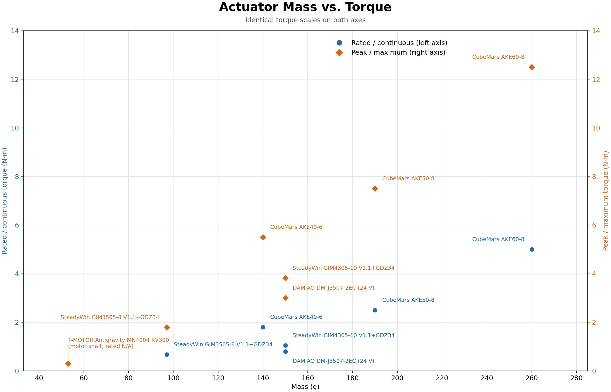

| 厂商/型号 | 重量 g | 额定/持续扭矩 N·m | 峰值/最大扭矩 N·m | 类型 | 尺寸 | 参数说明 | 来源 |
| --- | --- | --- | --- | --- | --- | --- | --- |
| T-MOTOR Antigravity MN4004 KV300 | 53 | N/A | 0.30 | 外转子无刷电机，300 rpm/V | Ø44.35 × 19 mm | 重量含线缆，不含减速器、编码器及外壳；峰值为电机轴端 @ 12 A，按 Solo Kt = 0.025 N·m/A 推算，非厂家额定值，持续时间未给出 | [厂家规格](https://store.tmotor.com/product/mn4004-kv300-motor-antigravity-type.html)；[ODRI 型号与重量](https://github.com/open-dynamic-robot-initiative/open_robot_actuator_hardware/blob/master/mechanics/actuator_module_v1/README.md#brushless-dc-motor)；[Solo 原始论文 §II-A](https://arxiv.org/html/1910.00093v2#S2.SS1) |

| Solo 集成参数与数据边界 | 数值／说明 | 来源 |
| --- | --- | --- |
| 减速比 | 9:1，两级同步带 | [Solo 原始论文 §II-A](https://arxiv.org/html/1910.00093v2#S2.SS1) |
| 关节端峰值力矩 | 原始执行器论文报告 2.7 N·m @ 12 A；电机轴端推算值为 2.7 / 9 = 0.30 N·m | [Solo 原始论文 §II-A](https://arxiv.org/html/1910.00093v2#S2.SS1) |
| Solo12 驱动配置限幅 | Kt = 0.025 N·m/A，限流 8 A，减速比 9；推算电机轴端 0.20 N·m、理想关节端 1.8 N·m。软件限幅不代表连续额定力矩 | [本地 solo12_driver.yaml](../../reference/robot_properties_solo/src/robot_properties_solo/resources/odri_control_interface/solo12_driver.yaml)；[固定版本上游配置](https://github.com/open-dynamic-robot-initiative/robot_properties_solo/blob/2201f454f4caffa0cad307fa8cbd1d64dd844008/src/robot_properties_solo/resources/odri_control_interface/solo12_driver.yaml) |
| 厂家峰值电流 | KV300 版本标注 9 A（180 s）；与 Solo 论文 12 A 驱动条件分别记录，不据此推定连续额定力矩 | [厂家规格](https://store.tmotor.com/product/mn4004-kv300-motor-antigravity-type.html) |
| 核对日期 | 2026-11-08 | 厂家规格、ODRI 硬件文档、Solo 原始论文及本地驱动配置 |

